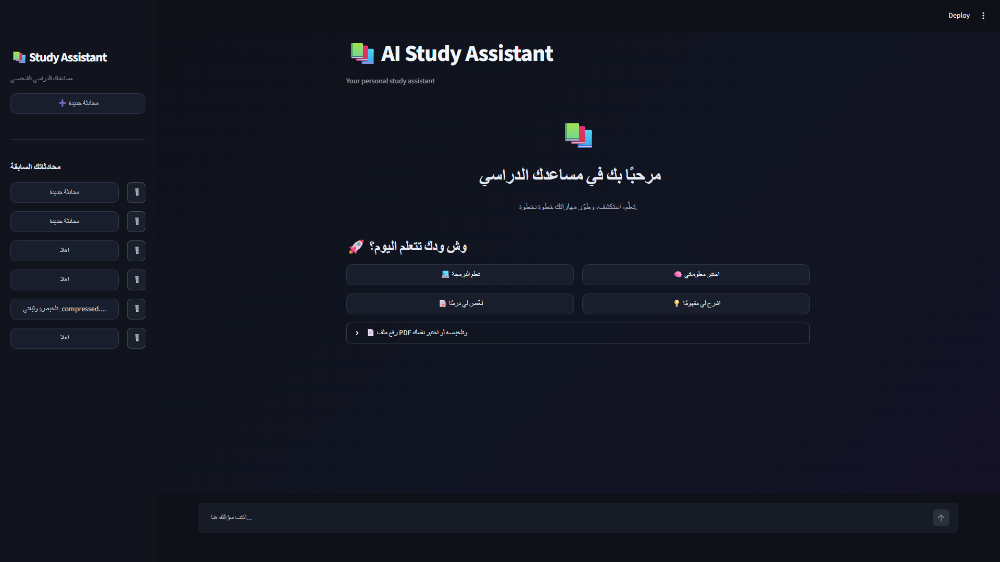
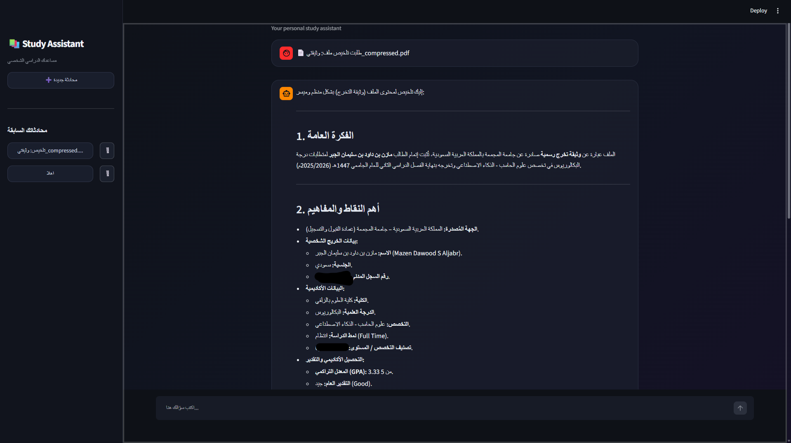

# AI Study Assistant 📚

An AI-powered study assistant built with Python and Streamlit to help students understand and review their study materials.

## Features

- **AI Chat Assistant:** Ask questions and receive AI-generated responses using the Google Gemini API.
- **PDF Summarization:** Upload PDF documents and summarize study materials.
- **Chat History:** Keep track of previous conversations.
- **Interactive Web Interface:** Use a simple, dark-themed interface built with Streamlit.
- **Secure API Configuration:** Store API credentials in environment variables.

## Technologies Used

- Python
- Streamlit
- Google Gemini API
- Google Gen AI SDK
- python-dotenv

## Getting Started

### 1. Clone the repository

```bash
git clone YOUR_GITHUB_REPOSITORY_URL
cd AI-Study-Assistant
```

### 2. Create a virtual environment

```bash
python -m venv .venv
```

Activate it on Windows:

```powershell
.venv\Scripts\Activate.ps1
```

### 3. Install dependencies

```bash
pip install -r requirements.txt
```

### 4. Configure the API key

Create a `.env` file in the project root directory and add your Google Gemini API key:

```env
GEMINI_API_KEY=your_api_key_here
```

Replace `your_api_key_here` with your own API key. Never upload your actual API key to GitHub.

### 5. Run the application

```bash
streamlit run app.py
```

## Project Status

**In Progress** — New features, improvements, and testing are ongoing.

## Author

Computer Science Graduate | Artificial Intelligence Track

## Screenshots

### Main Interface



### PDF Summarization

